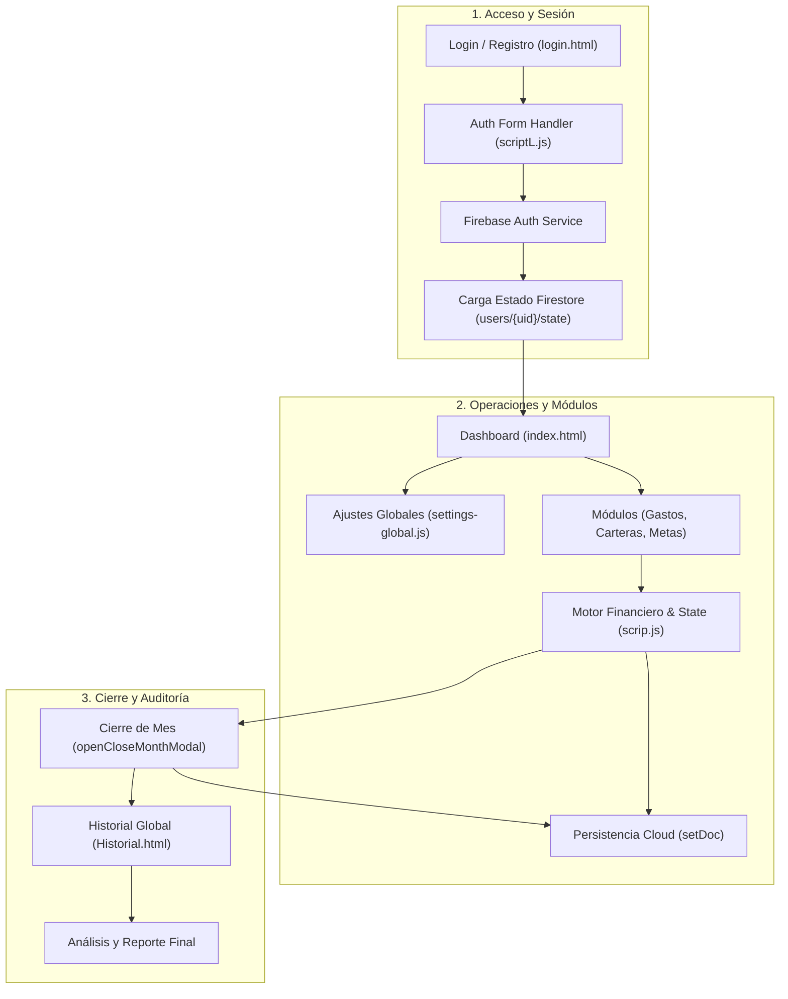

# Fin Flow FPR 💰📊

> **Plataforma web integral para la gestión financiera personal, control de presupuestos, administración de carteras y seguimiento de metas de ahorro con sincronización en tiempo real en la nube.**

[](https://firebase.google.com/)
[](https://tailwindcss.com/)
[](WorkFlow/workflow.html)
[](README.txt)

---

## 📋 Descripción General

**Fin Flow FPR** (`Proyecto-Finanzas`) es una aplicación web progresiva y reactiva orientada a resolver el control financiero personal de forma transparente, visual y segura. Cuenta con una arquitectura desacoplada que sincroniza el estado de las transacciones con **Google Firebase Firestore** y ofrece persistencia híbrida en **LocalStorage** para configuraciones de interfaz.

El flujo de trabajo, los carriles operativos y las dependencias de código han sido modelados y verificados con el estándar **Archify v2** en [`WorkFlow/workflow.json`](WorkFlow/workflow.json) y compilados en el visualizador interactivo [`workflow.html`](workflow.html).

---

## 🚀 Módulos y Funcionalidades

### 1. 🔐 Autenticación y Control de Sesión
- **Gestión de Identidad:** Registro de nuevos usuarios e inicio de sesión seguro mediante Firebase Authentication (`signInWithEmailAndPassword`, `createUserWithEmailAndPassword`).
- **Recuperación de Contraseña:** Flujo integrado con `sendPasswordResetEmail`.
- **Rutas Protegidas:** Detección de sesión activa con `onAuthStateChanged` en [`js/scriptL.js`](js/scriptL.js) y redirección automática si no existe credencial.

### 2. 📊 Dashboard Principal (`index.html`)
- **Métricas Clave (KPIs):** Balance total disponible, ingresos acumulados, gastos totales del ciclo y porcentaje de presupuesto ejercido.
- **Captura Rápida:** Formularios optimizados para el registro inmediato de ingresos y gastos con categorización dinámica.
- **Visualización Gráfica:** Desglose visual de gastos por categorías y análisis de saldo.

### 3. 💳 Cuentas y Carteras (`CuentasCarteras/`)
- **Multi-cuenta:** Gestión simultánea de efectivo, cuentas bancarias, tarjetas y billeteras digitales.
- **Historial de Cartera:** Consulta de movimientos filtrados por cuenta en [`CuentasCarteras/historialCartera.html`](CuentasCarteras/historialCartera.html).

### 4. 🧾 Gastos Diarios (`GastosDiarios/`)
- **Registro Rápido Diario:** Módulo específico para la captura ágil de microgastos cotidianos.
- **Historial Detallado:** Vista independiente en [`GastosDiarios/HistorialGastosD.html`](GastosDiarios/HistorialGastosD.html) con filtros por fecha y categoría.

### 5. 🎯 Objetivos de Ahorro (`Objetivos/`)
- **Metas Financieras:** Creación de objetivos con monto meta, fecha límite y descripción.
- **Barras de Progreso:** Seguimiento porcentual del avance según aportaciones acumuladas.

### 6. 🔄 Cierre de Mes e Historial Global (`Historial.html`)
- **Conciliación Mensual:** Modal de Cierre de Mes (`openCloseMonthModal`) que consolida los saldos del periodo, resetea el ciclo activo y archiva un snapshot en el arreglo `globalHistory`.
- **Auditoría Histórica:** Tabla de consulta, filtrado por periodo y exportación de históricos.

### 7. ⚙️ Ajustes Globales (`pages/Ajustes.html`)
- **Multi-moneda:** Soporte configurable para `$`, `€`, `Q` (Quetzales) y `£`.
- **Bilingüe (ES / EN):** Motor de traducción de etiquetas en [`js/settings-global.js`](js/settings-global.js).
- **Categorías Personalizadas:** Creación y edición de etiquetas de gasto a medida.

---

## 🏗️ Flujo de Trabajo y Arquitectura (Archify IR)

El sistema opera bajo un flujo estructurado en 4 carriles (*lanes*) y 3 fases cronológicas:



### Detalle de Carriles
1. **`client_ui` (Cliente Web):** Vistas HTML y componentes responsive (Tailwind CSS).
2. **`security_auth` (Seguridad):** Formularios de login y validación de tokens JWT en Firebase Auth.
3. **`app_logic` (Negocio):** Lógica reactiva de balance, validaciones y conciliación en [`js/scrip.js`](js/scrip.js).
4. **`cloud_storage` (Persistencia):** Colección `users` en Cloud Firestore y caché en LocalStorage.

---

## 📁 Estructura del Proyecto

```text
Proyecto-Finanzas/
├── config/
│   └── firebase.js                    # Inicialización y métodos de Firebase (Auth y Firestore)
├── css/
│   └── styles.css                      # Reglas de estilo personalizadas y resets
├── CuentasCarteras/
│   ├── CuentasCarteras.html            # Gestión de cuentas bancarias y carteras
│   ├── historialCartera.html           # Historial individual por cartera
│   ├── scriptCarterasCuentas.js        # Lógica de carteras y transacciones
│   └── scriptHistorialCarteras.js      # Filtros y renderizado de historial
├── GastosDiarios/
│   ├── GastosDiarios.html              # Registro ágil de gastos cotidianos
│   ├── HistorialGastosD.html           # Auditoría de gastos diarios
│   ├── scriptGastosD.js                # Lógica del módulo de gastos
│   └── scriptHistorialGastosD.js       # Manejo de registros y filtros
├── img/
│   └── grafico-de-barras.png           # Favicon e iconografía del sistema
├── js/
│   ├── scrip.js                        # Núcleo del Dashboard y sincronización de estado
│   ├── scriptAjustes.js                # Controlador de configuración de usuario
│   ├── scriptL.js                      # Controlador de autenticación y sesiones
│   ├── settings-global.js              # Manejo global de moneda, idioma y LocalStorage
│   └── slide.js                        # Control de navegación y menús colapsables
├── Objetivos/
│   ├── objetivosAhorros.html           # Vista de metas de ahorro
│   └── scriptObjetivos.js              # Lógica de creación y progreso de metas
├── pages/
│   ├── Ajustes.html                    # Panel de configuración general
│   ├── login.html                      # Vista de inicio de sesión y registro
│   └── PreguntasFPR.html               # Preguntas frecuentes y centro de ayuda
├── WorkFlow/
│   ├── README.md                       # Documentación técnica del modelo de flujo
│   ├── workflow.delivery.json          # Recibo de validación y checksums SHA-256
│   └── workflow.json                   # Especificación JSON-IR de Archify v2
├── Historial.html                      # Historial consolidado mes a mes
├── index.html                          # Dashboard principal
├── README.md                           # Documentación principal del proyecto
├── README.txt                          # Nota de derechos de autor y licencia
└── workflow.html                       # Diagrama interactivo autocontenido
```

---

## 🛠️ Tecnologías Empleadas

| Área | Tecnología | Propósito |
|---|---|---|
| **Frontend** | HTML5 semántico, CSS3, JavaScript ES Modules | Estructura y reactividad nativa sin dependencias pesadas |
| **Estilos** | [Tailwind CSS CDN](https://tailwindcss.com/) | Diseño utilitario, responsive y modo oscuro |
| **Iconos** | [FontAwesome 6](https://fontawesome.com/) | Simbología de interfaces y botones de navegación |
| **Autenticación** | Firebase Authentication 10.8 | Manejo seguro de usuarios, tokens y recuperación |
| **Persistencia Cloud** | Cloud Firestore 10.8 | Base de datos NoSQL para documentos de estado de usuario |
| **Persistencia Local** | Web Storage API (LocalStorage) | Preferencias de moneda (`finances_currency`) e idioma (`finances_lang`) |
| **Auditoría & Flujo** | [Archify 3.2](https://github.com/tt-a1i/archify) | Diagramado interactivo validado y trazabilidad de código |

---

## 🚀 Puesta en Marcha Local

Al ser una aplicación web basada en módulos ES nativos (`import`/`export`), debe ejecutarse a través de un servidor HTTP local para evitar restricciones de política CORS:

### Opción 1: Con Python (Rápido)
```bash
# Dentro de la carpeta raíz del proyecto:
python -m http.server 8000
```
Luego abre tu navegador en `http://localhost:8000`.

### Opción 2: Con Node.js / npx
```bash
npx serve .
```

### Opción 3: Extensión Live Server de VS Code
1. Abre la carpeta del proyecto en VS Code.
2. Haz clic derecho en `index.html` o `pages/login.html` y selecciona **Open with Live Server**.

---

## 🔍 Verificación e Integridad del Flujo de Trabajo

El artefacto [`workflow.html`](workflow.html) cuenta con verificación criptográfica y arquitectónica registrada en [`WorkFlow/workflow.delivery.json`](WorkFlow/workflow.delivery.json):

- **Receipt ID:** `1484989b-7fc7-410c-b357-ee7afe1c32fa`
- **Revision Git:** `14ce947b2106b63b8d9e4c0242a2ec040d4eff92`
- **Referencias de Código Verificadas:** 13 enlaces exactos a módulos fuente
- **Controles de Calidad Aprobados:** 9/9 compuertas estrictas (Clearance de etiquetas, geometría ortogonal, ausencia de cruces indebidos y legibilidad tipográfica).

---

## 👤 Autor

- **Angel Eduardo Carias Blanco**
- Proyecto: *Fin Flow FPR* (`Proyecto-Finanzas`)
- Copyright (c) 2026. Todos los derechos reservados.
